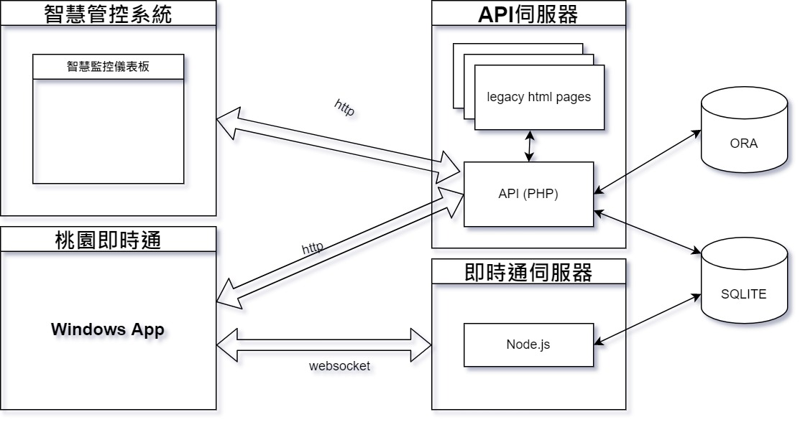

# LAH-FE - 智慧控管與監控系統前端 (Land Administration Hub FrontEnd)

`LAH-FE` 為地政智慧控管系統的 Web 前端應用程式，主要透過 HTTP REST API 與 `LAH-API` 伺服器溝通，並透過 WebSocket 與 `lah-messenger-server` 進行即時通訊。



## 核心架構與運作模式

本專案採 **純靜態 SPA (Static SPA) + PM2 背景排程** 的雙軌架構：

* **前端網站 (Static SPA)**：透過 Nuxt 2 的 `yarn generate` 編譯為純靜態 HTML/JS/CSS（輸出至 `dist/` 目錄），由 Apache 8080 連接埠作為虛擬主機（DocumentRoot）直接託管。
* **背景排程服務 (LAH-SCHEDULER)**：由 PM2 常駐守護 `scheduler/server.js`，負責定時排程、健康檢測與環境變數監控。
* **執行期動態設定 (Runtime Config)**：靜態頁面透過 `/runtime-config.js` 載入環境變數（`window.__LAH_CONFIG__`）。此檔案由 `LAH-SCHEDULER` 或安裝更新工具自伺服器本機的 `.env` 自動產出，確保靜態前端無需重新編譯即可即時套用正式環境組態。

## 主要技術棧 (Core Technologies)

* **核心框架**：Nuxt.js (`2.15.8`)
* **視圖框架**：Vue.js (`2.7.16`)
* **UI 元件庫**：BootstrapVue (`2.23.0`)
* **樣板引擎**：Pug (`^3.0.2`)
* **樣式編譯**：Dart Sass (`sass ^1.77.0`, `sass-loader ^10.2.0`)
* **圖表庫**：Chart.js (`3.9.1`)、vue-chartjs (`^4.0.3`)
* **HTTP 客戶端**：@nuxtjs/axios (`^5.12.2`)
* **執行期環境**：支援 Node.js v18 至 v26+（已全面相容最新可攜式 Node.js v26.13.0）

## 專案目錄結構

專案目錄遵循 Nuxt 2 規範與專案模組職責劃分：

* **`/assets`**：存放 SCSS 樣式、未編譯圖檔與全域資源。
* **`/components`**：存放可重複使用的 Vue 元件（遵循 `lah-*.vue` 命名慣例，並內建移植自即時通之 `lah-messenger-*.vue` 元件群）。
* **`/layouts`**：應用程式整體佈局，定義共用的頁首、側邊欄與頁尾。
* **`/mixins`**：共用 Vue Mixin 邏輯（如動態高度計算、資料快取存取等）。
* **`/pages`**：業務頁面與路由目錄，結構自動映射至系統 URL 路徑。
* **`/plugins`**：Vue 實例插件（如 axios 攔截器、Font Awesome 等）。
* **`/scheduler`**：背景服務程式碼（包含排程伺服器 `server.js` 與定時任務）。
* **`/store`**：Vuex 狀態管理模組（按業務劃分，如 `auth`、`inf`、`regcase` 等）。
* **`/static`**：純靜態外部資源目錄。
* **`yarn-build.bat`**：一鍵靜態網頁產製工具（自動適應 Node v26 與 OpenSSL legacy provider，建置後開啟 `dist/` 目錄）。
* **`ecosystem.config.js`**：PM2 常駐守護程序設定檔（定義 `LAH-SCHEDULER`）。
* **`nuxt.config.js`**：Nuxt 設定檔（宣告 SPA 靜態產製目標、代理伺服器規則與插件）。

## 開發與建置操作指南

### 1. 環境變數設定 (.env)

啟動開發伺服器前，請建立 `.env` 檔案：

```bash
# 複製範本建立設定檔
cp .env.example .env
```

請依本機或測試環境調整 `.env` 內容（如 `API_HOST`、`API_PORT`、`WEBSOCKET_HOST` 等）。

> [!CAUTION]
> 部署至遠端伺服器時，**切勿使用本機開發的 `.env` 覆蓋遠端檔案**，以免導致正式站台連線組態失效。

### 2. 套件安裝

本專案支援現代 Node.js 執行期（Node.js v18 / v20 / v22 / v26+）：

```bash
yarn install
```

### 3. 啟動本機開發伺服器

執行以下指令啟動具備熱重載（Hot Reload）的前端開發伺服器：

```bash
yarn dev
```

開發伺服器預設運行於 `http://localhost:8080`。

### 4. 產製靜態網頁 (Static Build)

若要產製供 Apache 託管或複製至遠端安裝目錄的靜態網頁：

* **方式一：執行一鍵產製腳本（推薦）**  
  在 Windows 檔案總管雙擊或於終端機執行：
  ```cmd
  yarn-build.bat
  ```
  該腳本會自動偵測 Node 執行期、注入 `--openssl-legacy-provider`、執行 `yarn generate` 並於完成後自動開啟 `dist\` 資料夾。

* **方式二：手動執行 Yarn 指令**  
  在 Node 17+ 環境下需帶上 OpenSSL 相容旗標：
  ```powershell
  $env:NODE_OPTIONS = "--openssl-legacy-provider"
  yarn generate
  ```
  產出之純靜態檔案位於 `dist\` 目錄。

## 主要業務功能模組

* **智慧控管（登記課）**：處理登記案件管理、即時狀態追蹤、逾期預警、補正展期與業務統計。
* **測量小幫手（測量課）**：處理測量外業案件排程、成果圖資查詢與自動化試算。
* **智慧監控（資訊課）**：提供資訊機房戰情看板、PowerHA 高可用狀態、主機資源負載、連線監控與資料庫備份檢測。
* **地價小幫手（地價課）**：處理地價查調、歷史地價比較與相關統計工具。
* **系統管理（系管課）**：使用者帳號管理、權限角色設定、操作稽核紀錄與系統參數配置。
* **即時通訊模組（跨課室協作）**：內嵌桃園即時通通訊元件，提供頻道公告、線上即時對話與附件傳遞功能。

## 版本演進紀錄

詳細版本演進與修改歷程請參閱 [CHANGELOG.md](./CHANGELOG.md)。
